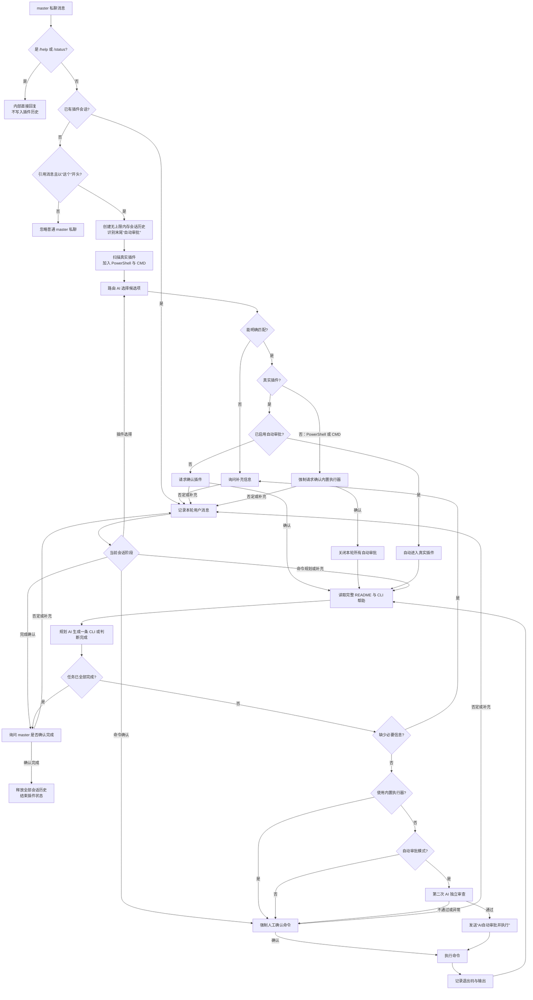

# QQ-AIreply

一个部署在 QQ 上的 AI 机器人。基于 [NapCat](https://github.com/NapNeko/NapCatQQ)（OneBot 11 实现）接入 QQ 消息，对接阿里云百炼（DashScope）OpenAI 兼容接口，实现群聊 / 私聊的智能问答。

## 功能特性

- **私聊问答**：任何人都可与机器人私聊（可在配置中关闭）
- **群聊问答**：被 `@` 或命中关键词时回复；指定群可启用自由聊天，由模型判断是否正在与机器人说话
- **群聊上下文**：按群隔离保存最近群消息、对机器人的 `@` 消息和机器人回复，并随请求一起交给 AI
- **图片理解**：支持群聊、普通私聊的单图/多图问答、图片文字识别，以及引用图片提问；含图请求可自动切换到视觉模型
- **图片历史**：图片独立保存 Base64、描述、编号和原文位置；默认向模型提供历史图片描述，也可提供原图，支持按编号发回原图
- **回复上下文**：引用（回复）某条消息时，机器人会把被引用消息的原文一并带给 AI 理解
- **AI 输出日志**：所有模型回复按本地日期追加保存到 `logs/YYYY-MM-DD.log`，包括普通回复及插件路由、规划、审批结果
- **角色扮演**：通过提示词支持让机器人扮演任意角色
- **主人内部指令**：仅保留 `/help` 和 `/status`；其他功能统一由插件提供
- **AI 插件交互**：主人私聊引用消息并发送以“这个”开头的要求后，AI 根据各插件 README 简介选择插件，可经确认连续调用多条 CLI，直至主人确认整个任务完成

## 工作原理

```
QQ 客户端 ──> NapCat（注入 QQ 进程，解析事件）
                 │  正向 HTTP 上报（事件）
                 ▼
QQ-AIreply 机器人（本地 HTTP 上报服务，默认 8081 端口）
                 │  libcurl 调用
                 ▼
阿里云百炼（DashScope OpenAI 兼容 chat/completions）
                 │  回复文本
                 ▼
机器人经 NapCat HTTP API 发送群聊 / 私聊消息
```

## 目录结构

```
.
├── src/               # 机器人源码（C++17）
│   ├── main.cpp       # 主程序：事件分发、群聊/私聊逻辑、主人指令
│   ├── config.*       # config.json 解析
│   ├── ai_client.*    # 阿里云百炼 AI 接口客户端（libcurl）
│   ├── onebot_api.*   # OneBot 11 HTTP API 客户端
│   ├── http_server.*  # 本地 HTTP 上报服务（NapCat 事件推送入口）
│   ├── group_history.*# 按群隔离、JSON 持久化的滚动聊天历史
│   └── test_ai.cpp    # AI 接口独立测试程序
├── thirdparty/        # 第三方头文件（nlohmann/json）
├── logs/              # 按日期保存的 AI 原始输出（运行时创建，不入库）
├── config.json        # 运行配置（含密钥，已被 git 忽略，不入库）
├── config_example.json# 配置模板（占位符，克隆后复制为 config.json 填写）
├── CMakeLists.txt     # 构建脚本
├── start_bot.ps1      # 一键启动 NapCat + 机器人
└── NapCat.Shell/      # NapCat 运行目录（自行下载，不入库）
```

## 环境要求

- Windows + [MSYS2 MinGW64](https://www.msys2.org/)（含 gcc、cmake、libcurl）
- **NapCat（Shell 版）**：本项目在 **v4.18.19** 上测试通过，保证支持该版本；其他版本兼容性未知，建议使用相同版本。下载后解压到项目根目录下的 `NapCat.Shell/`
  - 下载链接：<https://github.com/NapNeko/NapCatQQ/releases/download/v4.18.19/NapCat.Shell.zip>
- **QQ 客户端**：NapCat 对各 QQ 客户端版本兼容性不同，需选择与所用 NapCat 匹配的 QQ 版本，可前往 <https://rodert.github.io/qq-versions/> 下载任意版本。本项目在 **9.9.30_260429**（Windows x64）上测试通过：
  - 下载链接：<https://github.com/Rodert/qq-versions/releases/download/qq-windows-x64-9.9.30-20260429/QQ_9.9.30_260429_x64_01.exe>
  - 安装后请将实际路径填入 `config.json` 的 `qq_path`（详见下文配置说明）
- 一个用于登录 NapCat 的 QQ 号作为机器人本体
- 阿里云百炼 API Key（[开通地址](https://bailian.console.aliyun.com/)）

## 快速开始

### 1. 配置

```powershell
# 复制配置模板并填写真实信息
Copy-Item config_example.json config.json
```

编辑 `config.json`（复制自 `config_example.json`），按下面的说明逐项填写。下面以 `config_example.json` 为准，解释每一个字段：

**顶层字段**

| 字段 | 说明 |
| --- | --- |
| `napcat_http_base` | NapCat 正向 HTTP 服务的地址，格式 `http://IP:端口`。默认 NapCat 端口为 3000，若在 WebUI 中改动过端口需同步修改 |
| `napcat_token` | NapCat HTTP API 的 `access_token`。需登录 NapCat WebUI（默认 `http://127.0.0.1:6099/webui`），在「网络配置」中查看或设置该 token，**必须与 NapCat 中配置的完全一致**；若 NapCat 未启用鉴权则留空 |
| `http_report_port` | 机器人本地 HTTP 上报服务的监听端口（默认 8081）。NapCat 会把消息事件推送至此，需与 NapCat WebUI 中配置的 HTTP 上报地址端口一致 |
| `bot_qq` | 机器人自己的 QQ 号（即登录 NapCat 的那个账号），用于判断群消息中是否 `@` 了机器人 |
| `master_qq` | 主人 QQ 号。主人私聊可使用内部指令（`/help` / `/status`）和插件交互，普通内容不会进入聊天 AI。**若留空则没有"主人"概念**：私聊内部指令和插件交互均不生效，所有用户的私聊消息（`private_chat_enabled=true` 时）都会交给 AI 回复 |
| `qq_path` | 本机 QQ 客户端的完整安装路径，**必须替换为你实际安装的位置**，例如 `C:\Program Files\Tencent\QQNT\QQ.exe`。`start_bot.ps1` 会用它启动 QQ |
| `private_chat_enabled` | 是否允许**普通用户私聊 AI 回复**，默认 `true`。主人私聊始终走指令和插件流程，不受此开关影响，也不进入普通聊天 AI；未配置主人时，所有人的私聊均受此开关控制 |
| `group_free_talk` | 自由聊天群号数组，默认 `[]`。例如 `["123456789", "987654321"]`，也支持正整数群号。名单内的群在未 @、未命中关键词时，由模型判断是否有自然接话点，可主动参与开放讨论、回应分享和延续话题；名单外的群必须 @ 或命中关键词才回复 |
| `group_trigger_keywords` | 群聊触发关键词数组。消息即使没被 `@`，只要包含其中任意关键词也会回复；`[]` 表示不启用关键词触发 |
| `startup_history_sync_enabled` | 启动时静默补取离线群消息，默认 `true`；逐群分页回溯到上次成功同步时间，不限制为最近 20 条。设为 `false` 关闭启动补取 |
| `startup_history_initial_hours` | 没有该群同步进度时的初始回溯小时数，默认 `24`，范围 `1–8760`；已有进度时不受此时间窗限制 |
| `group_history_limit` | 每个群保留并发送给 AI 的最近群聊文本条数，默认 `100`；设为 `0` 可关闭这部分历史 |
| `group_interaction_history_limit` | 每个群分别保留的“@ 机器人消息”和“机器人全部成功回复/自身回显”条数，默认各 `30`；设为 `0` 可关闭这部分历史 |
| `image_understanding_enabled` | 是否读取当前消息、引用消息中的图片并交给模型理解，默认 `true`；关闭时不读取新图片，也不向模型提供历史图片及描述，已有图片数据保留 |
| `image_description_only_enabled` | 历史图片提供给模型的形式，默认 `true`：逐张生成描述和编号，模型的历史上下文只使用描述；`false`：历史上下文使用 Base64 原图，不额外生成描述和编号。两种模式都将原图保存在历史图片字段中，需开启图片理解；未触发回复的群消息也会记录，没有历史配额时不生成描述或编号 |

**`ai` 对象字段（阿里云百炼配置）**

| 字段 | 说明 |
| --- | --- |
| `ai.api_key` | 阿里云百炼 API Key（百炼控制台创建），用于调用大模型接口，**含敏感信息请勿提交仓库** |
| `ai.base_url` | OpenAI 兼容接口地址，可填写 API 基础地址（例如 `https://tokens.byteseek.ai/v1`）或完整的 `chat/completions` 地址。程序自动去除路径末尾斜杠，缺少 `/chat/completions` 时追加，保留查询参数；已有完整路径时不会重复追加。API 版本前缀需按服务商要求填写 |
| `ai.model` | 文本请求使用的模型名，如 `qwen-max`、`qwen-plus` 等，需与 `base_url` 所在账号/工作空间支持的模型一致 |
| `ai.vision_model` | 含图片的请求使用的视觉模型，例如 `qwen-vl-plus`；与文本模型共用 API 地址和密钥，须在该账号可用。留空时沿用 `ai.model`，此时该模型必须支持图片输入 |
| `ai.system_prompt` | 最高优先级的系统提示词，用于规定消息元数据、最终输出格式、真正 `@` 的标记格式和指令优先级 |
| `ai.user_prompt` | 用户提示词，用于定义机器人昵称、群聊人格、语气、角色扮演和一般行为偏好；程序会将其作为独立的 `user` 消息发送 |
| `ai.local_varibles` | 本地变量对象（字段名按此拼写），例如 `{"bot_name": "your_bot_name"}`。变量名不带方括号，值必须是字符串；可添加任意自定义变量 |
| `ai.free_talk_prompt` | 自由聊天参与判断提示词，支持 `[bot_name]` 等本地变量。默认偏向热情参与，同时避免重复附和、连续插话和打断私密交流。程序另附批量消息编号选择协议，判断结果不直接发到群里；实际回复的语气仍由系统及用户提示词控制 |

`ai.system_prompt`、`ai.user_prompt` 和 `ai.free_talk_prompt` 均可使用 `[变量名]`。启动时仅替换 `ai.local_varibles` 中已定义的变量，例如 `[bot_name]`；未定义的标记原样发送，所以 `[YYYY-MM-DD HH:MM:SS]`、`[@123456789]` 等不会被误删。变量名区分大小写，变量值允许为空字符串，替换只进行一遍，不继续展开变量值中的其他占位符。此处理仅用于配置的三段提示词，不替换用户消息、历史或模型输出。

旧配置需将顶层机器人名称移入 `ai.local_varibles.bot_name`，并将旧尖括号占位符改为 `[bot_name]`；运行时不再对机器人名称做特殊处理。未定义的 `[imageX]` 也会原样保留。请勿定义与时间、@ 或图片发送标记同名的本地变量，否则这些标记会按已定义变量替换。

升级已有配置时，在项目根目录执行 `python tools/migrate_config.py`。脚本会迁移本地配置和模板中的机器人名称及占位符，将旧 `image_history_enabled` 取反后改为 `image_description_only_enabled`，并补充发送原图的系统提示词；已有新字段优先保留。运行时仅读取新字段，不再读取旧开关。脚本还会删除 `group_need_at`，补充空的 `group_free_talk` 名单及默认 `ai.free_talk_prompt`；旧的全群自动回复行为不再生效，需要手动填写允许自由聊天的群号。

**AI 响应解析说明**

本项目在阿里云百炼 OpenAI 兼容接口上测试，测试使用的模型为 **`qwen-max`**。程序按以下优先级解析返回的 JSON（见 `src/ai_client.cpp`）：

1. 含 `error` 字段 → 报错并放弃本次回复；
2. 含 `choices` 数组 → 取 `choices[0].message.content`（OpenAI 兼容标准格式）；
3. 含 `text` 字段 → 直接取文本（部分接口的简化格式）。

> 注意：以上仅覆盖已知返回结构。若更换其他平台/模型（如其他服务商的兼容接口、DashScope 原生接口等），其返回 JSON 结构可能不同，需要同步调整 `src/ai_client.cpp` 中的响应解析逻辑。

> 注意：`config.json` 含敏感信息已被 `.gitignore` 排除，切勿提交到仓库。

### 2. 构建

```powershell
cmake -S . -B build -G "MinGW Makefiles" -DCMAKE_BUILD_TYPE=Release
cmake --build build -j
```

> 若 libcurl / MinGW 不在默认位置，请按本机环境修改 `CMakeLists.txt` 顶部的 `MSYS2_PREFIX` 路径。

### 3. 在 NapCat 中配置上报

先用 `start_bot.ps1` 启动 NapCat 并扫码登录 QQ，然后打开 WebUI（默认 `http://127.0.0.1:6099/webui`），在「网络配置」中新增一个**正向 HTTP 服务**并设置**消息事件上报**：

- **正向 HTTP 服务**（机器人调用 NapCat API 发消息用）：
  - 监听地址：`0.0.0.0`，端口 `3000`（需与 `config.json` 的 `napcat_http_base` 一致）
  - `access_token`：此处设置/查看的 token 就是 `config.json` 的 `napcat_token`，**两边必须完全一致**（留空表示不鉴权，则 `napcat_token` 也留空）
- **HTTP 上报服务**（NapCat 推消息事件给机器人用）：
  - 上报地址：`http://127.0.0.1:8081/`（端口需与 `config.json` 的 `http_report_port` 一致）

### 4. 启动

```powershell
# 一键启动 NapCat + 机器人
powershell -ExecutionPolicy Bypass -File .\start_bot.ps1
```

NapCat Shell 在 Windows 上需要管理员权限。若当前终端未提权，启动脚本会自动重新请求管理员权限；请在系统 UAC 窗口中手动确认。

也可以手动分别运行：先启动 NapCat，再运行 `build\qq_ai_reply.exe`。

### 启动时静默补历史

默认启动后主动获取群列表，再按群分页查询离线历史。每页 20 条只是请求批量，不是补取总数；程序向前翻页直到上次成功同步的时间边界。首次启用或新群没有同步进度时，默认回溯 24 小时，可通过 `startup_history_initial_hours` 调整。群消息仍遵循现有普通历史和交互历史配额，补取全部可获取的新消息并不意味着永久保存全部记录；两个历史配额均为 0 时不启动补取。

补入的消息只写历史，不调用自由聊天判断、正常聊天或发送接口，历史中的 @、关键词都不会触发回复。开启图片理解时保存可读取图片的 Base64 和原图编号；描述模式逐张额外调用视觉模型并将描述放在原图片位置，可能产生较多模型请求。图片过期或下载失败时记录占位，不向群里报错。当前新消息继续正常处理，同群导入中的单张图片处理可能使新消息短暂等待。

进度和平台消息 ID 随历史文件保存（格式版本 4，兼容旧版），重叠页、重复上报及重启时按 ID 去重。补取与实时消息按原始时间合并；仅成功到达边界才推进该群同步时间。群列表请求主动刷新缓存，失败后间隔 5 秒、最多重试 3 次（首次尝试之外，共最多 4 次）；成功取得列表后，每个群的历史补取也使用同样的重试间隔及上限。历史接口失败、分页停滞或格式不支持时保留原起点；每群只在首次失败及最终停止时输出失败详情，中间失败不重复刷屏。重试耗尽后本次启动不再补取该群，已入库消息不会回滚、不会假装同步完成，下次启动仍可重新尝试。日志会区分连接错误、HTTP 状态、OneBot 错误和响应格式问题，访问令牌脱敏。其他群和正常聊天继续工作。NapCat 的正向 HTTP 接口需将消息格式设为消息段数组。只静默导入早于本次机器人启动秒的消息；启动同秒及之后的事件按实时消息处理。

若提示“群列表暂不可用”，同步尚未开始读取群历史。连接失败时确认 NapCat 已登录且正向 HTTP 服务监听配置端口；HTTP 401/403 时检查访问令牌；HTTP 404 时检查 API 地址。等待同步入库后再询问旧消息，同步前已经发出的模型请求不会自动补上后来的历史。对于刚创建的群，全部消息都可能晚于初始时间边界：若 NapCat 查询更早记录时返回“消息不存在”或重复游标，程序保留进度重试，但此前已经取得的消息仍然入库并可供后续聊天使用，不会因为最后一页失败而回滚。

NapCat 终端显示旧消息不代表它会通过 OneBot 上报：官方接收逻辑明确跳过早于 NapCat 启动时间的消息。因此这里使用主动历史查询。能补到的范围受 QQ/NapCat 可返回的记录限制；接口报错或无法继续分页时不会声称全部补齐。本功能只补群聊，不补私聊，也不抓取终端日志。

官方依据（按当前主分支核对，实际部署版本可能不同）：

- [NapCat 官方 API 文档](https://napneko.github.io/onebot/api)
- [启动前消息过滤逻辑](https://github.com/NapNeko/NapCatQQ/blob/main/packages/napcat-onebot/index.ts)
- [获取群列表](https://github.com/NapNeko/NapCatQQ/blob/main/packages/napcat-onebot/action/group/GetGroupList.ts)
- [获取群历史及游标转换](https://github.com/NapNeko/NapCatQQ/blob/main/packages/napcat-onebot/action/go-cqhttp/GetGroupMsgHistory.ts)
- [历史默认顺序及底层调用](https://github.com/NapNeko/NapCatQQ/blob/main/packages/napcat-core/apis/msg.ts)

本地模拟接口集成测试：`python tests/test_startup_history.py build/image-history-fix/qq_ai_reply.exe`，覆盖多页、短页、重叠、历史图片、静默、实时消息、重启去重及接口失败；不会连接真实 QQ 或模型。

## 使用说明

- **群聊**：`@机器人 问题`，或发送包含触发关键词的消息；`group_free_talk` 名单中的群还支持语义判断后参与对话
- **私聊**：直接发消息即可（`private_chat_enabled` 控制开关）
- **主人内部指令**（仅 `master_qq` 私聊有效，目前只保留两个）：
  - `/help` — 查看帮助并实时列出 `plugins/` 中当前可用的插件
  - `/status` — 查看运行状态
- **插件功能**：引用一条消息并发送以 `这个` 开头的内容即可启动；AI 先路由到插件或内置执行器，再按普通/自动审批模式规划和执行 CLI
- **随时停止插件任务**：在插件会话的任意阶段单独发送 `停止`、`中断`、`取消`、`终止`、`退出任务`、`放弃`（或 `stop` / `cancel` / `abort`）即可释放会话并取消尚未开始的命令

### 群消息批处理与自动引用

每个群有独立的待处理队列，同一群最多运行一个 AI 处理流程。HTTP 上报入队后立即确认接收；机器人思考、处理图片或发送期间的新消息不会等待模型，而是在下一轮合并交给 AI。空闲时立即处理，不额外等待凑批；每批最多 50 条、约 64 KB 原始消息数据（单条超出时单独处理），剩余项继续排队。不同群互不等待。

- **自由聊天群**：整批普通消息只调用一次参与判断，结合机器人资料、引用文本和最多 20 条去重历史，返回 `{"reply_ids":["本地编号"]}`。判断只用文本和已有图片描述，不发送图片 Base64。同一人的补充、纠正可整体理解，模型无需逐条接话。艾特/关键词目标由本地强制保留，即使判断接口失败、返回越界或重复编号，也不会被普通消息的判断结果取消。
- **非自由聊天群**：不询问模型哪些消息需要回复，本地仅选中艾特/关键词消息；同批其他消息只作语境。
- **正式回复**：把候选目标一次交给聊天模型，要求返回 `{"replies":[{"target_id":"本地编号","text":"正文"}],"skipped_ids":[]}`。本地严格检查每个候选必须在回复或跳过列表中恰好出现一次；非法结果不发到群里。按原始接收顺序发送选中的回复，避免混淆不同群友。
- **按需原生引用**：正式回复返回 `skipped_ids`，允许模型合并同一话题、跳过已被覆盖或过时的候选，不再强制每个艾特/关键词目标都发言。普通接梗和当前话题默认不引用；只有对象不清楚、专门回答较早的具体问题、或原消息已被较多新消息挤远时，正文才加一个 `[&本地编号]`。程序严格校验该编号并将其转换为真实 OneBot `reply` 段；没有标记则不引用，没有真实平台 ID 也不伪造。正文的艾特和历史原图标记仍可使用。
- **机器人历史**：机器人成功发送的每条群回复都会保存到普通历史和机器人回复历史，并尽量记录发送后的真实 `message_id`；NapCat 的 `message_sent` 回显只作上下文、不会再次触发 AI。模型必须先阅读自己的历史发言，避免同一话题逐条复读；独立问题、明确追问和新进展仍保持热情回应。
- **编号与状态**：模型输入携带 `[#会话编号-序号]`，并明确区分待处理消息、仅作上下文和历史处理状态；持久化历史保存已回复、已判断不回复、判断失败、生成失败、发送失败等状态。历史只用作理解，不重新逐条回答；重复平台消息 ID 在排队和完成后均去重。
- **聊天语气**：只有群友主动问为什么集中回复或回复晚了，才结合聊天记录自然幽默地接话；严肃、焦急场景不硬开玩笑，也不主动暴露队列和编号。

为兼容已有配置，程序在请求的系统提示词末尾附加批量协议，覆盖旧配置中“只回答最后一条”“只输出正文”和单条布尔判断的传输规则；原有自定义人格、语气仍保留，普通私聊和主人插件流程不变。`ai.free_talk_prompt` 仍控制参与偏好，编号及 JSON 协议由程序负责。

**失败与重启边界**：待处理队列只保存在内存中，重启不重放未完成回复，历史中已开始但未结束的任务标为“处理已中断”。模型/发送失败记录终态并继续处理后续批次；不自动重发发送请求，以免超时但实际已送达时产生重复消息。真实 QQ 引用展示及模型遵循提示词的效果仍取决于实际服务。本地模拟测试不连接真实 QQ 或付费模型。

批处理集成测试：`python tests/test_group_batch.py build/image-history-fix/qq_ai_reply.exe`。覆盖思考期间接收、多群隔离、积压合并、直接触发保留、非法编号、生成/发送失败、原生引用与超量分批。

插件目录按 `plugins/<插件ID>/` 组织。程序会自动扫描一级目录，从 README 的一级大标题读取名称，并把“大标题之后到下一个标题之前”的内容作为插件简介。选择插件时只向 AI 提供所有插件的名称和简介；进入所选插件后才读取其完整 README 和 CLI `--help`。真实插件的 CLI 参数以数组直接传入进程，不经过 shell，因此不需要为每个插件编写定制 C++ 代码。普通模式下每次执行前都会把完整命令发给主人确认；自动审批模式下则按下述规则复核。否定或其他回复会作为补充信息交给 AI 重新规划。

插件路由还包含两个写死的内置执行器：PowerShell 和 CMD。路由始终优先选择真实插件；只有用户明确要求执行系统命令且没有插件适合时才使用内置执行器。两者都适用时优先 PowerShell，CMD 仅用于明确依赖 CMD 或批处理语法的场景。选择任一内置执行器都必须由主人明确确认，即使本轮请求了自动审批也不会跳过；主人确认进入后，本轮自动审批会被关闭，后续每一条 PowerShell/CMD 命令都必须人工确认。PowerShell 参数被强制限定为 `-NoProfile -NonInteractive -Command <命令>`，CMD 参数被强制限定为 `/d /s /c <命令>`。

一次插件任务可以连续规划和执行多条 CLI 命令，但受运行机制限制，每轮只能规划并执行其中一条。需要先列举、搜索、读取状态或取得精确 ID 时，AI 会先执行这一条准备命令，再根据返回结果规划下一条；审批 AI 会按“是否为整个任务链中合理的当前步骤”判断，不会仅因一条安全的查询命令无法独自完成最终目标而拒绝。规划 AI 给出的操作说明会包含本步目的、与最终目标的关系、预期结果及其后续用途，并标明是只读准备步骤还是修改步骤；说明下方还会按照实际参数顺序逐项解释每个参数的作用和来源，这些解释也会交给审批 AI 核对。从最初的“这个”请求开始，主人和机器人的每一句对话都会保存在当前内存会话中，不设条数上限，并在每次规划时一并交给 AI。AI 判断全部目标已完成后会再向主人询问；只有主人明确确认完成，程序才会释放本轮全部会话历史并退出插件状态。未确认时，后续消息会继续作为补充要求处理。

若最初的“这个……”请求以 `自动审批` 结尾，本轮会启用自动审批模式。路由 AI 能明确匹配插件时会自动进入该插件；无法判断插件时才向主人询问。插件路由、规划和审批等结构化 AI 请求使用零温度以降低随机性。规划 AI 每返回一条 CLI 命令，程序会先检查逐项参数说明是否完整且与参数原值对应，再通过一个短上下文审查独立核对 ID、名称和内容值的映射，最后复核命令是否符合原始要求、README、CLI 帮助及安全约束。全部通过时机器人会发送“AI自动审批并执行”并立即执行；任一项未通过或审查失败时只把该条命令交给主人手动确认。无论是否启用自动审批，任务最终完成仍必须由主人确认后才会退出并释放历史。

插件会话期间可以随时单独发送 `停止`、`中断`、`取消` 等中止关键词。等待选择、等待补充、等待命令确认和等待完成确认时会立即退出；若 AI 请求或 CLI 命令已经开始，会先确认收到停止请求，在当前步骤返回后丢弃其结果并退出，不再执行下一条命令。为避免破坏插件数据，已经启动的 CLI 进程不会被强制终止，已经成功执行的操作也不会自动回滚。

### 插件调用逻辑



> **若 `master_qq` 留空**：机器人不再区分主人与普通用户——私聊内部指令和插件交互不生效，所有用户的私聊消息都会（在 `private_chat_enabled=true` 时）交给 AI 回复，相当于"来者不拒"模式。群聊行为不受 `master_qq` 影响。
- **回复上下文**：引用一条消息发送，机器人会结合被引用消息理解后回答
- **群聊历史**：历史按群号隔离并保存在 `userdata/group_history.json`，包含时间、发送者和文本，重启后自动恢复。每个数组超过配置上限时从头部丢弃最旧记录。机器人成功发送到群里的回复也会进入普通群聊历史，只有实际 `@` 机器人的消息及其回复会进入专门的交互历史
- **图片历史**：历史格式版本为 3，原始文字保存在 `text`；每张图片在 `images` 数组中独立保存 `mime_type`、`base64`、`description`、`id` 和 `text_offset`（在原文中的 UTF-8 字节偏移），可还原文字与多张图片的顺序。描述模式逐张生成约 200～500 字的客观描述和原图编号，构建历史上下文时在图片原来的位置展开描述，明确标为图片附件，不拼进用户原文，也不作为回复发送。原图模式不额外生成描述或编号，相应字段为空，历史请求使用原图。当前消息及引用消息始终按图片理解设置使用原图，不附加自动描述。描述失败会写入图片的描述字段，不影响本次原图问答。
- **历史兼容**：切换图片模式或关闭图片理解不再清除已保存的原图。旧版追加在正文中的自动描述会在启动时迁移到图片字段，并尝试从原图缓存恢复 Base64；缓存缺失时保留描述和编号。旧记录未保存图片位置，只能迁移到原文末尾。旧原图记录没有描述时不会自动补调模型，描述模式下会标记暂无描述，可引用原图继续询问。
- **发送原图**：原图缓存在 `userdata/image_cache/<群号>/<编号>.b64`，编号是完整数字标识，并非每条消息从 1 开始的图片序号。模型输出 `[image123]` 等上下文中明确提供的标记后，程序将其转换为真实图片消息段，可与文字、@ 和多张图片混排。描述模式下历史图片带有编号；群聊当前消息及引用消息中的图片也会逐张提供发送编号，与对应原图一同传给模型，因此引用原图重发不依赖旧历史是否还在、是否开启描述模式或是否有历史配额。发送时仅查找当前群缓存，找不到时显示 `[原图不可用]`。此功能需开启图片理解；目前可重发已有原图，没有生成或编辑新图片的接口。
- **原图缓存保留**：原图缓存重启后仍可读取，目前不会随历史条数淘汰或自动清理，也不会因关闭图片理解而删除，长期运行会占用磁盘。可在停止机器人后手动清理不再需要的缓存；对应历史编号随后将无法发送原图。

### 图片理解使用方法

1. 在配置中保持 `image_understanding_enabled` 为 `true`，将 `ai.vision_model` 配置为接口支持的视觉模型（模板使用 `qwen-vl-plus`）。修改配置后重启机器人。
2. 群聊中在同一条消息里发送 `@机器人 这张图里是什么？` 并附图，也可以引用一条图片消息后发送 `@机器人 帮我识别图片里的文字`。仍遵循原来的 @ / 关键词触发规则。
3. 普通用户私聊可直接发图片，或把图片和问题一起发送；仅发图片不再自动添加“描述图片”的指令，由模型结合聊天提示词自然回应。需要描述或识字时明确提问即可。多张图片可一起发送，主人私聊仍保留指令和插件工作流。
4. 图片历史默认采用文字描述模式：只要群消息需要保存历史，每张图片都会额外调用一次视觉模型生成描述和编号。生成描述本身不会发送群消息，是否回复仍遵循 @、关键词和自由聊天判断。后续可询问先前图片或要求发回原图；需要描述之外的细节时可引用原图。将 `image_description_only_enabled` 设为 `false` 后，历史上下文改为使用原图。
5. 两种模式都在本地历史保存 Base64。描述模式增加收图时的模型调用和处理时间，原图模式增加后续请求大小。关闭 `image_understanding_enabled` 时不读取新图片、不生成描述；所有适用历史配额均为 0 时也不生成描述。私聊没有持久化聊天历史，因此不额外生成历史描述。

NapCat 需要以 OneBot 消息段数组上报图片。当前支持消息中的 Base64、data URL、文件标识、本地路径和 HTTP(S) 下载地址；若任一图片无法取得，会提示重新发送，不会把缺图的问题交给模型猜测。图片以 Base64 多模态内容发送，视觉模型无需直接访问 QQ 图片地址。图片中的小字或模糊细节能否识别取决于模型能力和图片质量。

本地回归测试可在构建后运行 `python tests/test_image_understanding.py build/qq_ai_reply.exe`；群聊触发和私聊权限回归运行 `python tests/test_free_talk.py build/qq_ai_reply.exe`。测试在临时目录启动机器人，并模拟 NapCat 和模型接口，不使用真实密钥、不发送真实 QQ 消息。

## 隐私与安全

- API Key、Token、QQ 号等敏感信息仅存于本地 `config.json`，不入库
- AI 原始输出按本地日期保存在 `logs/`，可能包含对话和插件操作内容，整个目录已被 Git 忽略
- 群聊上下文保存在 `userdata/group_history.json`，描述模式的原图另存于 `userdata/image_cache/`，NapCat 运行数据保存在 `NapCat.Shell/`，均不入库；描述模式只减少模型历史中的图片数据，不代表本地不保存原图
- 请勿将本机器人用于任何违法或骚扰用途
